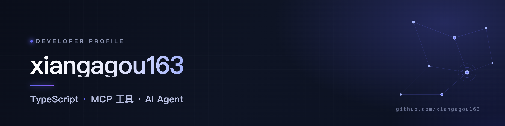

  

<h3 align="center">你好，我是 xiangagou163 👋</h3>

  <em>折腾 MCP 与 AI Agent 工具 · TypeScript · Shell</em>

  用 <b>TypeScript</b> / <b>Shell</b> 写 MCP 服务器与开发者工具，关注 AI Agent 的工具生态。 
  Building MCP servers and developer tooling in TypeScript &amp; Shell, exploring the AI agent ecosystem.

---

### 🧰 技术栈 · Tech Stack

  
  
  
  
  
  
  

### 📊 GitHub 统计 · Stats

  

  

  

### 🚀 精选项目 · Featured Projects

| 项目 Project | 简介 | 链接 |
| :--- | :--- | :--- |
| **tdengine_mcp** | TDengine 的 MCP 服务器 | [仓库](https://github.com/xiangagou163/tdengine_mcp) |
| **custom-skills** | 自定义 skills 集合（Shell） | [仓库](https://github.com/xiangagou163/custom-skills) |
| **dbhub** | 零依赖、token 高效的数据库 MCP 服务器 | [仓库](https://github.com/xiangagou163/dbhub) |
| **Trellis** | 面向 Agent 的 harness | [仓库](https://github.com/xiangagou163/Trellis) |

### 🔗 我的其他账号 · Also on

  
  

感谢访问 · Thanks for stopping by ✦

